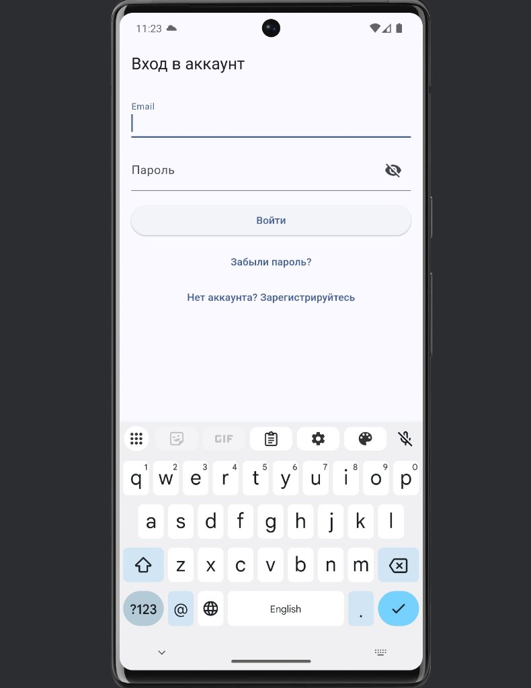
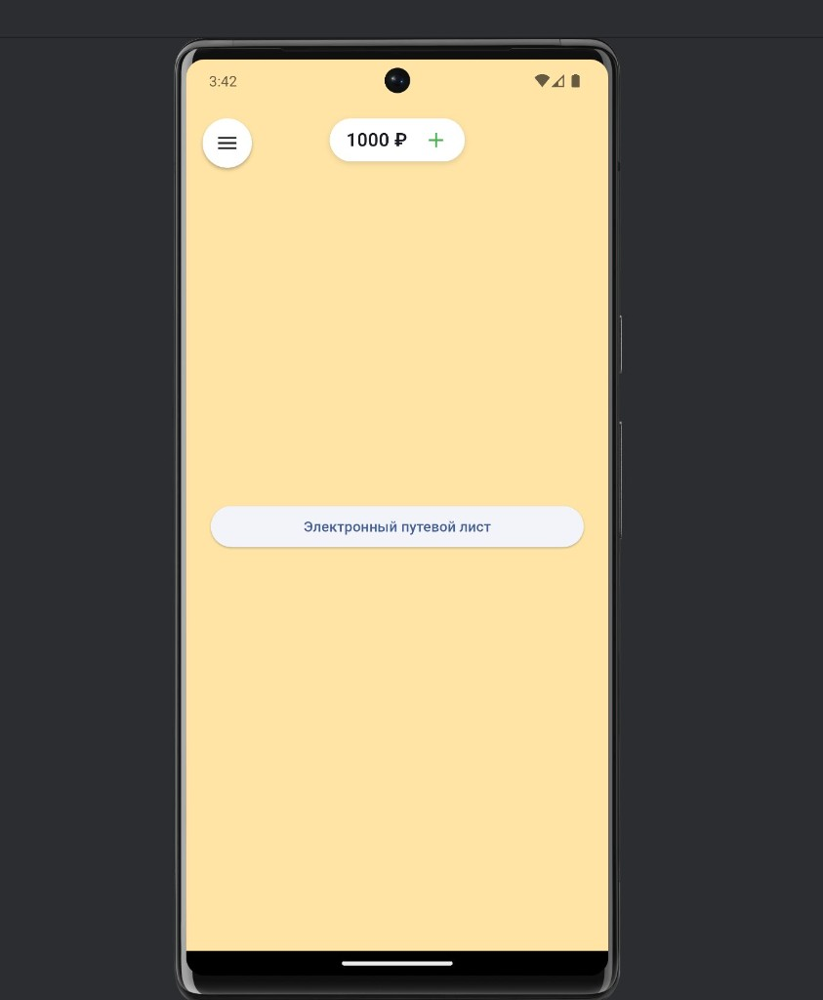
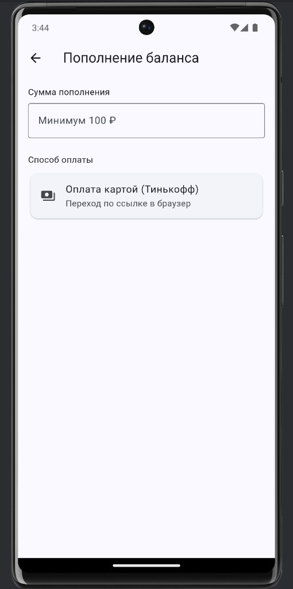
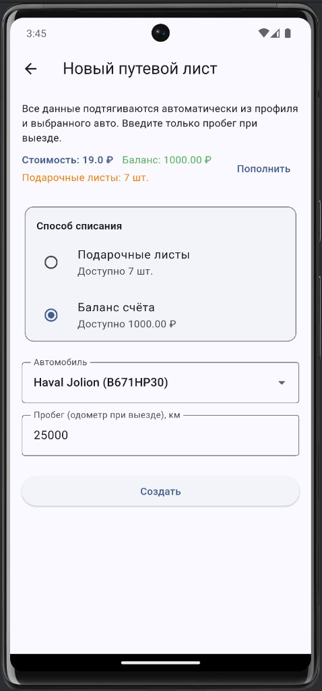
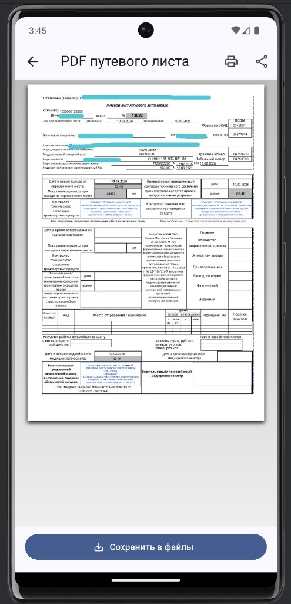

# Ingooz — Электронные путевые листы

Мобильное приложение для оформления электронных путевых листов легкового автомобиля. Flutter + Supabase.

## Возможности

- **Вход и регистрация** — email/пароль, восстановление пароля, подтверждение почты
- **Пополнение баланса** — оплата картой через Тинькофф
- **Профиль** — ФИО, ИНН, водительское удостоверение, адрес
- **Автомобили** — добавление ТС, данные владельца
- **Путевые листы** — создание, списание с баланса или подарочных листов
- **PDF** — генерация и сохранение путевого листа в файлы
- **Промокоды** — использование подарочных листов

## Скриншоты

| Вход | Главная | Пополнение баланса |
|------|---------|--------------------|
|  |  |  |

| Новый путевой лист | PDF путевого листа |
|--------------------|--------------------|
|  |  |

## Начало работы

### Требования

- Flutter 3.x
- Dart 3.x

### Установка

```bash
git clone <repo>
cd ingoozapp
flutter pub get
cp .env.example .env   # заполните SUPABASE_URL и SUPABASE_ANON_KEY
flutter run
```

### Сборка

```bash
# APK
flutter build apk --release

# iOS
flutter build ios --release
```

## Лицензия

Проприетарный проект.
