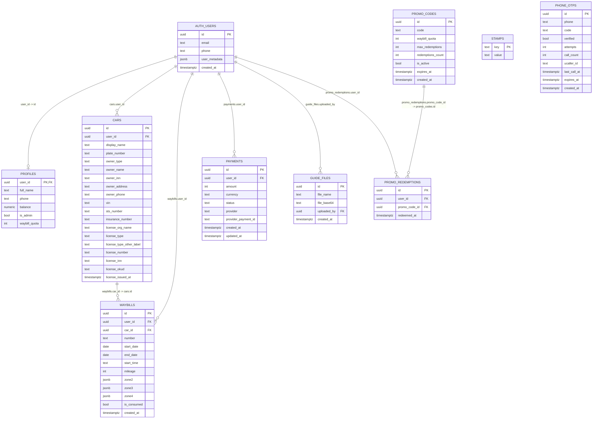

# Ingooz — База данных (ER)

Документ составлен по текущему коду Flutter и SQL-файлам в репозитории.  
Ниже — практическая диаграмма сущностей и связей, используемых приложением.

## ER-диаграмма

## Назначение таблиц

- `profiles` — профиль пользователя, роль администратора, баланс, квота путевых листов.
- `cars` — транспорт пользователя и реквизиты собственника/лицензиата.
- `waybills` — путевые листы, включая зоны печатной формы (`zone2`, `zone3`, `zone4`).
- `payments` — операции пополнения (Tinkoff), статусы оплаты.
- `promo_codes`, `promo_redemptions` — промокоды и факты их активации пользователями.
- `stamps` — админ-настройки печатей и цена путевого листа (`key/value`).
- `guide_files` — PDF-файлы памятки, загружаемые администратором.
- `phone_otps` — техническая таблица OTP для телефонной авторизации (uCaller).

## Примечания

- Для `phone_otps` в проекте есть SQL с RLS (только `service_role` через Edge Function).
- Часть ограничений/политик для остальных таблиц управляется на стороне Supabase проекта и должна проверяться отдельно через SQL Editor/Policies.
